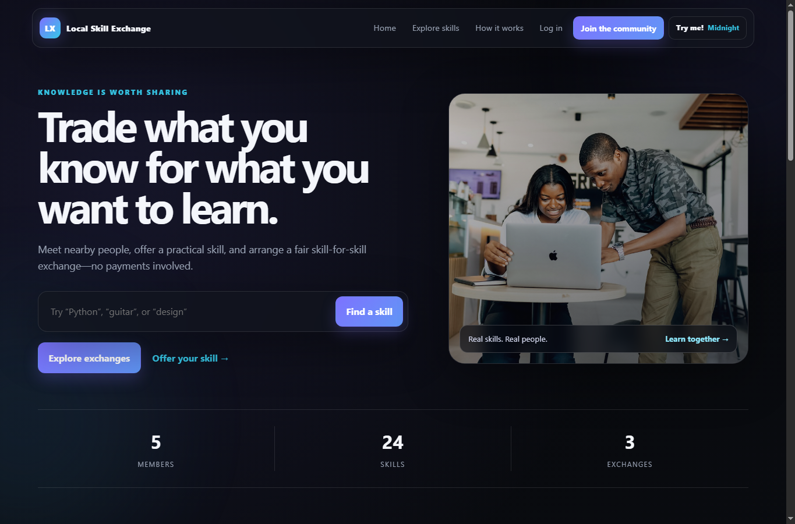

# Local Skill Exchange

> **Client project:** This application was developed for a client. It is published here as a portfolio and technical reference project. Client reports, local databases, user uploads, and development environments are intentionally excluded from the repository.

A full-stack community platform for exchanging skills without traditional payment. Members can publish skills, discover local learning opportunities, request exchanges, chat, schedule sessions, and review completed exchanges.



## Features

- Member registration, authentication, and editable profiles
- Searchable skill listings with categories and filters
- Saved skills and exchange requests
- Built-in conversations and file attachments
- Session scheduling and completion workflow
- Ratings and reviews
- Notifications and administrator controls
- Seeded demonstration content
- Automated integration tests

## Tech stack

- Python and Flask
- Flask-SQLAlchemy with SQLite
- Flask-Login and Flask-WTF
- Jinja templates, HTML, CSS, and JavaScript
- Pillow for image handling
- Pytest

## Local setup

Python 3.12 or newer is recommended.

```bash
python -m venv .venv
```

Activate the environment:

```powershell
.venv\Scripts\Activate.ps1
```

On macOS or Linux:

```bash
source .venv/bin/activate
```

Install dependencies and start the app:

```bash
pip install -r requirements.txt
python run.py
```

Open <http://127.0.0.1:5000>. Windows users can alternatively run `START.bat`.

## Configuration

Set a strong `SECRET_KEY` in your shell or deployment platform before using the application outside local development. See `.env.example` for the expected variable.

The application creates and seeds its local SQLite database automatically on first start. Runtime databases and uploaded attachments are not committed.

## Demo accounts

| Role | Email | Password |
| --- | --- | --- |
| Administrator | `admin@gmail.com` | `admin` |
| Member | `tarun@localskill.demo` | `User@123` |

Additional seeded member accounts use the password `User@123`. All included credentials are demonstration-only and must be replaced for a production deployment.

## Tests

```bash
python -m pytest -q
```

The test suite covers public pages and search, registration and login, administrator authorization, skill ownership, saved listings, exchanges, chat attachments, reviews, and suspended users.

## Deployment note

GitHub hosts the source code and runs the automated tests. Because this is a server-side Flask application, GitHub Pages cannot run it directly. Deploy it to a Python-capable service and configure a secure secret key and persistent database before production use.

